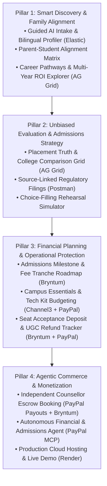
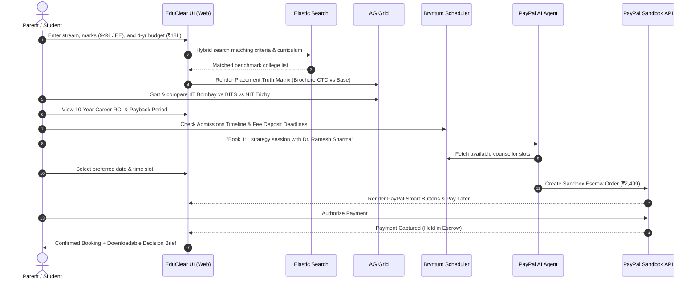

# EduClear — Business Requirements Document (BRD)
> **Tagline:** *Clear Truth in Higher Education, Career Advisory & Financial Planning*  
> **Platform Name:** **EduClear**  
> **Target Event:** PayPal AI Hackathon 2026 ($67,500+ Prize Pool)  
> **Target Audience:** College Aspirants (UG & PG), Parents/Guardians, Independent Certified Career Counsellors  
> **Target Sponsors:** PayPal, AG Grid, Bryntum, Channel3, Render, Elastic, Zapier, Postman  

---

## 1. Executive Summary & Why EduClear Exists

### 1.1 The Broken Status Quo
Choosing a college is the **second largest financial investment** an Indian family makes, ranging from ₹10 Lakhs to ₹45+ Lakhs. Yet the entire advisory industry is distorted by hidden incentives:

```mermaid
flowchart LR
    subgraph Traditional_Portals["The Broken System (Conflict of Interest)"]
        College["Private Colleges"] -- "Pays ₹50k - ₹3L Referral Kickback" --> Broker["College Directories & Free Counsellors"]
        Broker -- "Pushes High-Fee / Low-Quality Colleges" --> Victim["Unsuspecting Students & Parents"]
    end

    subgraph EduClear_System["The EduClear Model (100% Independent)"]
        Family["Students & Parents"] -- "Transparent Micro-Fee (₹999 - ₹2,999)" --> EduClear["EduClear Platform & AI"]
        EduClear -- "Unvarnished Audited Data & Unbiased Advice" --> Family
        EduClear -- "Zero Commercial Kickbacks Allowed" -.-> College2["Colleges (Objectively Evaluated)"]
    end
```

* **Predatory Marketing:** Universities highlight single outlier packages (e.g. "₹1.2 Crore International Offer!") in glossy brochures while hiding that the **actual domestic median base salary is ₹8–12 LPA**.
* **Distorted Placement Rates:** Colleges claim "100% Placements" by shrinking the denominator—excluding unplaced students, mass recruiter dropouts, or those forced into higher studies.
* **First-Semester Shock:** Parents budget only for tuition and hostel, getting blindsided by ₹1,00,000+ in mandatory academic hardware (AI laptops, specialized software, lab kits).
* **Forfeited Deposits:** Families forfeit hard-earned seat acceptance fees (₹35,000 to ₹1,00,000) because multi-portal admission deadlines and UGC 100% refund cutoff dates are opaque and chaotic.

### 1.2 The EduClear Solution
**EduClear** is a student-first, independent career counseling and higher education intelligence platform:
1. **100% Student-Funded & Independent:** Zero affiliate commissions from colleges. What you see is mathematically verified data.
2. **Placement Truth:** Exposes true in-hand base salaries and complete placement denominators.
3. **Career Trajectory & Degree ROI:** Looks beyond Day 1 campus placement to show Year 0, Year 3, and Year 5–10 salary compounding and exact **"Time-to-Debt-Freedom"** (payback period).
4. **Agentic Financial Planning (PayPal):** AI agents calculate 4-year cash flows, model loan EMI burdens, and execute transparent payments and milestone-based counsellor booking via **PayPal**.

---

## 2. User Personas (Who We Are Building For)

### 🧑‍🎓 Persona 1: Aditya (The Student Aspirant)
* **Profile:** 18 years old, scored 94.2 percentile in JEE Main / 88% in 12th Board.
* **Goal:** Wants to study Computer Science or Electronics, but unsure whether to choose a high-fee private university (₹28 Lakhs total) or a top State Govt/NIT college (₹10 Lakhs total).
* **Pain Point:** Overwhelmed by marketing hype and contradictory advice from relatives; wants to know what actual graduates earn 3–5 years into their career.

### 👨‍👩‍👦 Persona 2: Rajesh & Sunita (The Parents)
* **Profile:** Salaried middle-class parents with ₹15 Lakhs saved for education.
* **Goal:** Ensure their child gets a high-quality education without taking on a debilitating 15-year education loan.
* **Pain Point:** Afraid of hidden fees, sudden fee hikes, and missing refund deadlines when juggling seat allotments across multiple rounds.

### 👩‍🏫 Persona 3: Dr. Ramesh Sharma (The Independent Counsellor)
* **Profile:** Former Dean of Academic Affairs (IIT Roorkee), 22+ years of educational mentoring.
* **Goal:** Offer ethical, fee-only counseling to deserving families without being pressured by university affiliate networks.
* **Pain Point:** Managing schedules, chasing parents for booking fees, and lacking an audited platform to prove his independence.

---

## 3. Product Features at a Glance (The 4 Pillars)

EduClear delivers **12 cohesive features** grouped into 4 distinct pillars:



---

## 4. Deep-Dive Feature Specifications

### Pillar 1: Smart Discovery & Family Alignment

#### Feature 1: Guided AI Intake & Bilingual Profiler
* **What it does:** Welcomes the family in English or Hindi and accepts natural conversational input (e.g. *"I got 93 percentile in JEE Main, our budget is 18 Lakhs total, and we want North or West India"*).
* **Why it matters:** Eliminates rigid, confusing 50-field forms. Converts everyday language into structured, editable profile fields.
* **Sponsor Integration:** **Elasticsearch (Elastic)** — Uses hybrid vector search to semantically match free-text student interests with college curricula and emerging tech specializations.

#### Feature 2: Parent-Student "Family Alignment Matrix"
* **What it does:** The student and parent independently fill out a 2-minute micro-survey rating their priorities (Brand Prestige, Branch Passion, Location/Safety, and Budget Strictness).
* **Why it matters:** Resolves emotional deadlock at home. The AI generates an **Alignment Score** (e.g., 82% aligned) and provides a structured "Dinner Table Discussion Guide" highlighting natural compromises.

#### Feature 3: Career Pathways & Multi-Year Degree ROI Explorer
* **What it does:** Visualizes what happens *after* college across 3 stages:
  * **Year 0 Starting Salary:** Audited domestic median base.
  * **Year 2–5 Mid-Career:** Real-world role transitions (e.g. SDE-1 $\rightarrow$ Senior SDE; Analyst $\rightarrow$ Senior Consultant).
  * **Year 5–10 Senior Roles:** Leadership bands and salary ceilings.
  * **Time-to-Debt-Freedom (Payback Period):** Calculates exact months required to recover total 4-year fees from disposable salary.
* **Why it matters:** Stops families from borrowing ₹30 Lakhs for degrees that take 18 years to break even.
* **Sponsor Integration:** **AG Grid & AG Charts** — High-performance career trajectory area charts and interactive comparison tables.

---

### Pillar 2: Unbiased Evaluation & Admissions Strategy

#### Feature 4: Side-by-Side "Placement Truth" Matrix
* **What it does:** A comprehensive comparison grid that lays bare official college claims vs. verified realities:
  * **Headline Brochure CTC:** Highlights the misleading ₹1+ Crore marketing figure.
  * **Audited Median Base Salary:** Reveals the true recurring domestic base pay (e.g. ₹18.5 LPA).
  * **True Placement Denominator:** Shows $\frac{\text{Placed Students}}{\text{Eligible Students}}$, explicitly accounting for unplaced students.
  * **Accreditation & NIRF Rank:** Shows NAAC grade, NBA accreditation, and official government ranking.
  * **Zero-Commission Badge:** Displays an explicit "0% Commercial Relationship" guarantee.
* **Why it matters:** Restores data transparency to higher education.
* **Sponsor Integration:** **AG Grid (AG Studio & Custom Widgets)** — Competing for the **$10,000 AG Grid Cash Prize**.

#### Feature 5: Source-Linked Regulatory Filings & Audit Trail
* **What it does:** Every data point and AI rationale features a clickable badge linking directly to the institution's official NIRF regulatory filing, State Fee Regulatory Committee circular, or Supreme Court mandate.
* **Why it matters:** Eliminates AI hallucinations and gives parents concrete proof they can trust.
* **Sponsor Integration:** **Postman** — Documented public API collection and automated endpoint verification tests.

#### Feature 6: JoSAA / State Counselling Choice-Filling Rehearsal Simulator
* **What it does:** An interactive preference list simulator where students drag and drop college-branch pairs.
* **Why it matters:** Prevents "order inversion" (ranking a low-cutoff college above a dream option), which permanently locks students out of better colleges in Round 1. Real-time AI alerts warn of risky ordering.

---

### Pillar 3: Financial Planning & Operational Protection

#### Feature 7: Admissions Milestone & Critical Fee Deposit Roadmap
* **What it does:** An interactive Gantt/Timeline displaying multi-round application release dates, entrance exams, seat allotment rounds, and **mandatory seat acceptance fee deposit windows** (e.g. ₹35,000 within 96 hours).
* **Why it matters:** Prevents families from forfeiting allocated seats due to missed deposit windows.
* **Sponsor Integration:** **Bryntum (Timeline & Scheduler)** — Competing for the **$3,000 Bryntum Cash Prize**.

#### Feature 8: "Campus Essentials & Tech Kit" Budgeting
* **What it does:** Automatically calculates the mandatory hardware and supplies required for the student's chosen branch (e.g. AI-capable GPU laptop for CS; drafting equipment for Civil/Mech; professional attire for MBA).
* **Why it matters:** Pulls live market prices, product titles, and buy links, adding them to the all-inclusive 4-year budget with a 1-click **PayPal Checkout / PayPal Pay Later** option.
* **Sponsor Integration:** **Channel3 API** (Competing for the **$1,500 Channel3 Cash Prize**) + **PayPal JS SDK v6**.

#### Feature 9: Seat Acceptance Deposit & UGC Refund Protection Tracker
* **What it does:** Tracks advance seat deposits paid across multiple institutions, sends automated countdown alerts before the **UGC 100% Fee Refund Cutoff**, and generates a legally grounded refund request letter if an institution delays payment.
* **Why it matters:** Protects family capital during high-stress multi-round counseling.
* **Sponsor Integration:** **PayPal Webhooks / Dispute Simulation** + **Bryntum Deadlines**.

---

### Pillar 4: Agentic Commerce & Monetization

#### Feature 10: Verified Independent Counsellor Booking with Escrow Payouts
* **What it does:** Parents browse vetted, independent counsellors bound by a zero-commission oath, pick an open slot on their interactive schedule, and book a 1:1 video consultation.
* **How payments work:** The family pays via **PayPal Sandbox Checkout**. Funds are held securely in milestone escrow and automatically released to the counsellor's account via **PayPal Payouts API** upon session completion.
* **Sponsor Integration:** **PayPal Payouts API**, **Bryntum Scheduler**, and **Zapier MCP** (automated Google Calendar & Zoom invites).

#### Feature 11: Autonomous Financial & Admissions Agent (Agentic Commerce)
* **What it does:** An intelligent conversational agent that evaluates 4-year affordability, calculates net cash deficits per semester, compares loan EMI burdens, and autonomously creates PayPal sandbox checkout orders when requested by the family.
* **Why it matters:** Seamlessly bridges deep financial intelligence with automated transactional execution.
* **Sponsor Integration:** **PayPal Agent Toolkit & MCP Server** — Targeting **Best Use of Agentic Commerce ($5,000)** and **Best Use of PayPal + AI ($5,000)**.

#### Feature 12: Production Cloud Deployment & Live Hosted Demo
* **What it does:** Deploys the complete full-stack web application with continuous integration and a public, fast URL for hackathon judges and parents.
* **Sponsor Integration:** **Render Cloud Platform** — Targeting the **Render Track ($2,250 Credits)**.

---

## 5. Hackathon Sponsor Maximization Strategy

EduClear is deliberately engineered to satisfy the judging rubrics of **multiple hackathon sponsor categories simultaneously**:

| Sponsor | Primary Prize / Benefit | Exact EduClear Module / Integration |
| :--- | :--- | :--- |
| **PayPal** | **Grand Prizes ($25k) + Agentic Commerce ($5k) + PayPal+AI ($5k)** | Features 8, 9, 10, 11 (Smart Buttons, Pay Later, Payouts Escrow, MCP Agent) |
| **AG Grid** | **$10,000 Cash** (1st: $5k, 2nd: $2k, 3rd: $1k) | Features 3, 4 (Placement Truth Matrix, Salary Growth Charts) |
| **Bryntum** | **$3,000 Cash** ($1,000 x 3 winners) | Features 7, 9, 10 (Admissions Gantt & Counsellor Booking Scheduler) |
| **Channel3** | **$1,500 Cash** (1 winner) | Feature 8 (Campus Tech & Essentials Product Catalog API) |
| **Render** | **$2,250 Credits** + $50 free credits | Feature 12 (Live demo hosting & zero-downtime deploys) |
| **Elastic** | Agent Builder / Search Recognition | Feature 1 (Hybrid vector course & curriculum search) |
| **Zapier** | MCP Automation | Feature 10 (Calendar & SMS post-booking automation) |
| **Postman** | API Documentation & Monitoring | Feature 5 (Public API testing collection & documentation) |

---

## 6. End-to-End User Journey Walkthrough



---

## 7. Non-Functional Requirements & Safeguards

1. **Child & Minor Data Safeguarding:** The platform handles students under 18 years of age. Personal records, exam roll numbers, and contact details are strictly kept private, never sold, and never shared with commercial entities (adhering to DPDP Act principles).
2. **Speed & Responsiveness:** Interactive grid filtering across 1,000+ data combinations completes in under 50ms; page loads under 1.8 seconds.
3. **Auditability:** Every metric displayed has a clear, timestamped citation to official government filings or university board circulars.
4. **Resilience:** Fallback mock states ensure that even if external third-party sandbox APIs experience latency, the demo remains 100% stable.

---

## 8. Definition of Done for Hackathon Submission

* [x] **Clear Brand Identity:** **EduClear** established as the independent, student-first platform.
* [x] **Fully Functional Demo:** All 4 pillars active, connecting the student intake to the AG Grid matrix, Bryntum timeline, and PayPal sandbox checkout.
* [x] **Multi-Sponsor Depth:** Cohesive, legitimate integrations of PayPal, AG Grid, Bryntum, Channel3, and Render.
* [x] **Public Code Repository:** Public GitHub repository with open-source license.
* [x] **Demo Video:** Under 3 minutes, showing the working application end-to-end.
* [x] **Live Hosted URL:** Deployed and publicly accessible on Render.
