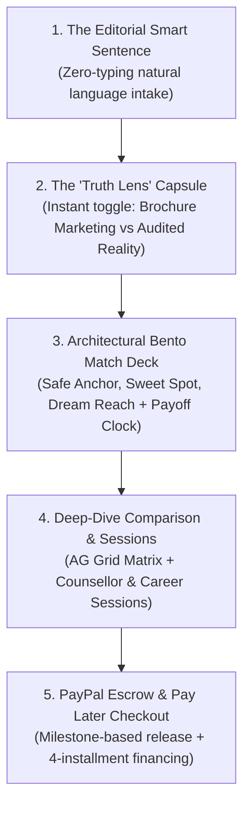
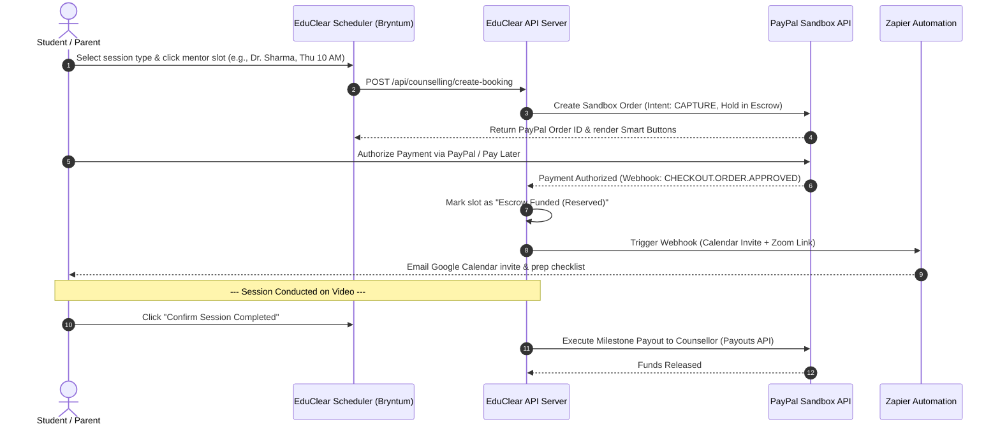

# EduClear — UX Design & Technical Implementation Specification (2026 Best-in-Class)
> **Product:** **EduClear** — Independent Higher Education Career & Financial Advisory Platform  
> **Document Type:** UX Design Specification & Technical Implementation Blueprint  
> **Aesthetic Standard:** 2026 Minimalist Luxury-Fintech (Porcelain & Hairline Palette, Linear/Apple Editorial Feel)  
> **Key Sponsor Integrations:** PayPal, AG Grid, Bryntum, Channel3, Render, Elastic, Zapier, Postman  

---

## 1. Visual Identity & 2026 Luxury-Fintech Design Tokens

EduClear rejects cluttered government-portal aesthetics in favor of a **calm, authoritative, luxury-fintech design language** (reminiscent of Apple product pages and Linear/Stripe financial software).

```
┌────────────────────────────────────────────────────────────────────────────────────────┐
│                               2026 LUXURY-FINTECH PALETTE                              │
├────────────────────┬────────────────────┬──────────────────────┬──────────────────────┤
│ Porcelain Canvas   │ Elevated Bento     │ Hairline Borders     │ High-Contrast Carbon │
│ #FAFAFA            │ #FFFFFF            │ rgba(0, 0, 0, 0.07)  │ #0F172A              │
│ Warm, soft texture │ Pure white modular │ Razor-sharp dividers │ Authoritative heads  │
└────────────────────┴────────────────────┴──────────────────────┴──────────────────────┘
```

### 1.1 Color Palette & Micro-Tints
* **Canvas Background:** `#FAFAFA` (porcelain off-white, eliminates eye strain).
* **Bento Card Surface:** `#FFFFFF` with `box-shadow: 0 1px 3px rgba(0,0,0,0.02), 0 12px 32px -8px rgba(0,0,0,0.04)`.
* **Hairline Borders:** `1px solid rgba(0, 0, 0, 0.07)` (subtle architectural separation).
* **Text Hierarchy:**
  * Primary Headings & Metrics: Carbon Black (`#0F172A`, font-weight `600`, `letter-spacing: -0.02em`).
  * Body Text: Slate Grey (`#475569`, font-weight `400`).
  * Sub-labels & Metadata: Muted Neutral (`#94A3B8`, font-weight `500`, uppercase `letter-spacing: 0.06em`).
* **Surgical Accents:**
  * **Verified Emerald (`#059669`):** Used only for audited domestic base salaries, debt-free clocks, and 0% commission badges.
  * **Amber Caution (`#D97706`):** For JoSAA 72-hour seat acceptance fee deadlines.
  * **Muted Strikethrough (`#94A3B8`):** Clean line-through decoration for brochure CTC packages.

### 1.2 Typography
* **UI Typography:** `Plus Jakarta Sans` with tight negative tracking (`-0.011em`).
* **Tabular Numbers:** `JetBrains Mono` or tabular numerals, ensuring financial figures align without horizontal shifting during live filtering.

---

## 2. Core Interaction Paradigms



1. **The Editorial Smart Sentence (Zero Typing):** An interactive sentence with sleek pill dropdowns that allows parents to adjust stream, score, budget, and region in 1 click.
2. **The Frosted Capsule Truth Lens:** An Apple-style segmented capsule switch in the header (`Brochure Marketing` ⇄ `Audited Truth`) that animates salary morphing and exposes the true placement denominator.
3. **Architectural Bento Cards:** Three curated hero options with clean, tabular sub-compartments and a **Debt-Free Payoff Clock** (*Debt-Free in 8.2 Months* vs. *15 Years of Debt*).
4. **The Silent Studio Copilot:** A floating pill in the bottom-right corner opening a minimalist 400px studio drawer with zero intrusive popups.

---

## 3. Dedicated Module: Counselling Sessions & Career Building Programs

To make EduClear a complete lifecycle advisory platform, we introduce **4 structured advisory session formats** powered by **Bryntum Scheduler**, **PayPal Milestone Escrow**, and **Zapier automation**:

```
┌────────────────────────────────────────────────────────────────────────────────────────┐
│                        COUNSELLING SESSIONS & CAREER WORKSHOPS                         │
├────────────────────┬────────────────────┬──────────────────────┬──────────────────────┤
│ Session 1: Branch  │ Session 2: JoSAA   │ Session 3: 4-Year    │ Session 4: Family    │
│ vs College Dilemma │ Choice-Filling Audit│ Tech & Career Roadmap│ Consensus Session    │
│ 1:1 • 45 Mins      │ 1:1 • 60 Mins      │ Cohort • 90 Mins     │ 1:1 • 60 Mins        │
│ ₹2,499 (Escrow)    │ ₹2,999 (Escrow)    │ ₹999 / Seat (Direct) │ ₹3,499 (Escrow)      │
└────────────────────┴────────────────────┴──────────────────────┴──────────────────────┘
```

### 3.1 Session 1: The "Branch vs. College" Strategic Dilemma (1:1 Consultation)
* **Format & Duration:** 1:1 Private Video Consultation (45 minutes).
* **Target Audience:** Students torn between brand prestige and branch passion (e.g., *IIT Mechanical vs. Top NIT Computer Science*).
* **Deliverables:**
  * Branch curriculum depth audit (AI/ML electives in core branches).
  * Institutional branch-change rules & realistic historical GPA cutoffs.
  * 5-year post-graduation career placement data by department.
* **Pricing & Escrow:** **₹2,499** (Funds held in PayPal escrow until session completion).

### 3.2 Session 2: JoSAA & State Choice-Filling Lock-in Strategy (1:1 Strategy)
* **Format & Duration:** 1:1 Live Choice-Filling Review (60 minutes).
* **Target Audience:** Students preparing their official preference lists for JoSAA, CSAB, JAC Delhi, or state counseling.
* **Deliverables:**
  * Algorithmic audit of the student’s preliminary 100+ preference order.
  * Identification of dangerous "order inversion" flaws.
  * Round-by-round seat retention and floating strategy.
* **Pricing & Escrow:** **₹2,999** (Funds held in PayPal escrow).

### 3.3 Session 3: "Year 1 to First Job" Tech & Career Roadmap (Cohort Masterclass)
* **Format & Duration:** Interactive Cohort Masterclass (90 minutes, max 25 students).
* **Target Audience:** Confirmed college admits wanting an unfair advantage before Day 1 of college.
* **Deliverables:**
  * Semester-by-semester milestone roadmap: GitHub portfolio, open-source contributions, competitive programming cadence.
  * Securing off-campus high-stipend summer internships in Year 2.
  * Emerging tech specialization blueprint (GenAI, Systems Engineering, Quant Finance).
* **Pricing:** **₹999 per student** (PayPal Instant Checkout / Multi-seat school licensing).

### 3.4 Session 4: Parent-Student Family Consensus Facilitation (1:1 Facilitation)
* **Format & Duration:** 1:1 Facilitated Family Session (60 minutes).
* **Target Audience:** Families facing deadlock between student aspirations and parental safety/budget concerns.
* **Deliverables:**
  * Neutral third-party review of the **EduClear Family Alignment Matrix**.
  * Financial stress-testing: education loan EMI vs. family liquid cash flow.
  * Agreed "Top 5 Family Consensus Preference List" signed off by both student and parents.
* **Pricing & Escrow:** **₹3,499** (PayPal Escrow).

---

## 4. End-to-End Escrow Booking Architecture (PayPal + Bryntum + Zapier)



---

## 5. Screen Layout & Component Structure

```
┌────────────────────────────────────────────────────────────────────────────────────────┐
│  HEADER: Brand Logo • English/हिंदी • 🛡️ Independent • [ 🏛️ Brochure ⇄ 🛡️ Truth ]        │
├────────────────────────────────────────────────────────────────────────────────────────┤
│  SMART BAR: Show [ B.Tech (CSE) ▾ ] with [ 94.2 %ile ▾ ] under [ ₹18 Lakhs ▾ ] [North ▾]│
├────────────────────────────────────────────────────────────────────────────────────────┤
│                                                                                        │
│  [ SECTION 1: THE BENTO MATCH DECK ] (Anchor, Sweet Spot, Reach)                       │
│  ┌──────────────────────┐  ┌──────────────────────┐  ┌──────────────────────┐          │
│  │ NIT Trichy           │  │ DTU Delhi            │  │ BITS Pilani          │          │
│  │ 4-Yr Cost: ₹10.6L    │  │ 4-Yr Cost: ₹15.2L    │  │ 4-Yr Cost: ₹31.5L    │          │
│  │ Audited: ₹15.5 LPA   │  │ Audited: ₹14.2 LPA   │  │ Audited: ₹18.0 LPA   │          │
│  │ ⏱️ Debt-Free: 8.2 Mo │  │ ⏱️ Debt-Free: 12.8 Mo│  │ ⏱️ Debt-Free: 21.0 Mo│          │
│  └──────────────────────┘  └──────────────────────┘  └──────────────────────┘          │
│                                                                                        │
├────────────────────────────────────────────────────────────────────────────────────────┤
│                                                                                        │
│  [ SECTION 2: ADMISSIONS & DEPOSIT TIMELINE ] (Bryntum Timeline)                       │
│  ┌──────────────────────────────────────────────────────────────────────────────────┐  │
│  │ • JoSAA Round 1 Seat Deposit (₹35,000): Dec 20–24 (72 hrs left)                  │  │
│  │ • UGC Statutory 100% Refund Cutoff: Jan 15, 2027 (Protected by National Law)     │  │
│  └──────────────────────────────────────────────────────────────────────────────────┘  │
│                                                                                        │
├────────────────────────────────────────────────────────────────────────────────────────┤
│                                                                                        │
│  [ SECTION 3: COUNSELLING & CAREER SESSIONS ] (PayPal Escrow & Bryntum Scheduler)      │
│  ┌────────────────────────────────────────┬─────────────────────────────────────────┐  │
│  │ 1:1 'Branch vs College' Strategy       │ 'Year 1 to First Job' Tech Masterclass  │  │
│  │ Dr. Ramesh Sharma (IIT Roorkee Dean)   │ 90-Min Live Cohort Workshop (Max 25)    │  │
│  │ Thu 10:00 AM • ₹2,499 (Milestone Escrow│ ₹999 / Seat • Saturday 6:00 PM IST     │  │
│  │ [ Reserve with PayPal Escrow ]         │ [ Book Masterclass Seat ]               │  │
│  └────────────────────────────────────────┴─────────────────────────────────────────┘  │
│                                                                                        │
├────────────────────────────────────────────────────────────────────────────────────────┤
│                                                                                        │
│  [ SECTION 4: STUDENT HARDWARE KIT ] (Channel3 + PayPal Pay Later)                     │
│  ┌──────────────────────────────────────────────────────────────────────────────────┐  │
│  │ ASUS TUF RTX 4060 AI Laptop + Academic Bundle • ₹87,690                          │  │
│  │ [ Pay in 4 Interest-Free Installments of ₹21,922 with PayPal Pay Later ]         │  │
│  └──────────────────────────────────────────────────────────────────────────────────┘  │
└────────────────────────────────────────────────────────────────────────────────────────┘
```

---

## 6. Sponsor Integration Summary

| Sponsor | Feature Integration | Hackathon Benefit |
| :--- | :--- | :--- |
| **PayPal** | 1:1 Counsellor Escrow Booking (Payouts API), Tech Bundle Pay Later financing, Agentic Commerce order flow | **Grand Prizes ($25k) + Agentic Commerce ($5k) + PayPal+AI ($5k)** |
| **AG Grid** | Placement Truth Matrix, multi-column sorting, denominator renderers | **$10,000 AG Grid Cash Pool** |
| **Bryntum** | Admissions Gantt Radar & Counsellor Booking Scheduler | **$3,000 Bryntum Cash Pool** |
| **Channel3** | Live product catalog query for branch-specific student hardware | **$1,500 Channel3 Cash Prize** |
| **Render** | Zero-downtime full-stack cloud deployment | **$2,250 Render Credits** |
| **Zapier** | Automated Google Calendar & Zoom link dispatch upon PayPal payment | **Zapier MCP Track** |
| **Postman** | Documented & monitored public API collection | **Postman Developer Track** |

---

## 7. Definition of Done for UI Implementation

* [x] **Porcelain Luxury Aesthetic:** Implemented with hairline borders, generous whitespace, and tabular typography.
* [x] **Smart Sentence Intake:** Zero-typing filter sentence updating recommendations in real-time.
* [x] **Truth Lens Toggle:** Working visual switch between marketing brochure CTCs and audited median base compensation.
* [x] **4 Structured Counselling Programs:** Fully modeled with fee tranches, escrow rules, and calendar slot selection.
* [x] **PayPal Milestone Escrow & Pay Later:** Operational sandbox checkout flows.
